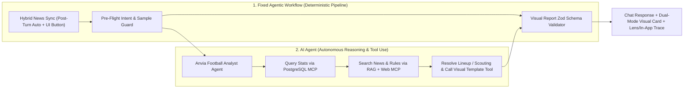

# PRD: Halfspace — Indonesia Super League Intelligence & Visual Report Assistant

- **Course**: AI Product Engineering with TypeScript Batch II — Final Assignment (Day 19)
- **Core Stack**: TypeScript Monorepo (`pnpm`), `@anvia/core`, `@anvia/server`, `@anvia/react-ui`, Hono, TanStack Router, PostgreSQL (read-only match analytics + dedicated `halfspace` schema for `pgvector` RAG & session memory), MCP (`@modelcontextprotocol/sdk`), `@anvia/core/evals`, and Anvia Lens (+ Built-in In-App Trace Summary).

---

## 01 · Problem + User — *Who hurts, and what does it cost?*

- **Target Users (Non-Technical)**: Football journalists, sports content creators, pundits, and club coaching/scouting staff covering the **Indonesia Super League (Liga 1)**.
- **The Pain**: These users need data-driven insights and visual graphics every matchweek, but **they do not know SQL, cannot code, and do not know where to pull clean match data**. Today, to prepare a single pre-match preview or player scouting breakdown, they must:
  1. Manually click through dozens of match pages on consumer score apps and copy numbers by hand.
  2. Dig through scattered Indonesian sports news portals to check who is injured, doubtful (`50/50`), suspended (card accumulation), or called up to the National Team before predicting a starting XI.
  3. Spend hours manually designing stat cards or waiting on a data analyst / graphic designer to build comparison visuals.
- **The Cost**: **2–3 hours of manual browsing and formatting per match/player report**, resulting in surface-level commentary (relying only on goals/assists because advanced metrics like xG, shot maps, or possession-adjusted defense are inaccessible to non-coders) and wrong lineup predictions due to missed news or regulation details.

---

## 02 · Trigger → Output — *What starts a run, what comes out?*

- **Trigger (Chat-First + 1-Click Matchweek Bar for Non-Technical Users)**:
  - On the Home screen (`/`), the user can click any fixture from the live **"Jadwal & Big Match Liga 1"** bar, pick one of the **3 Quick-Start Use Case Cards**, or chat in natural language (Bahasa Indonesia / English):
    1. **Player Scouting**: *"Carikan gelandang U-23 lokal di Liga 1 musim ini yang bagus dalam progresi bola dan bertahan."*
    2. **Pre-Match Analysis & Lineup Prediction**: *"Analisis prematch Persib vs Persija minggu ini dan prediksi starting XI-nya berdasarkan performa terakhir dan berita cedera/akumulasi kartu."*
    3. **Visual Report Generation**: *"Buatkan report evolusi dua musim (25/26 vs 26/27) untuk pemain ini lengkap dengan visual card-nya."*
- **Output (Conversational Analysis + Inline Visual Cards with Dual PNG Export)**:
  1. **Grounded Narrative & Lineup Breakdown**: Clear, jargon-free tactical explanation combining match statistics with cited news updates (`[doc_id]`) and Liga 1 regulations.
  2. **3 Inline Visual Report Templates (`@anvia/react-ui` Custom Tool Parts)** with **1-Click Export PNG (`Editorial Dark #090A0F` or `Transparent / Clean Mode`)**:
     - **`PlayerScoutingCard`**: Percentile bars (`0–100`), per-90 & possession-adjusted (`PAdj`) metrics, two-season evolution deltas (`25/26` → `26/27`), and `Early Season Sample` badges when active-season minutes are `180–449`.
     - **`PrematchLineupCard`**: Side-by-side pitch formation diagram (11 starters per team with `U-23` / `Foreign` badges, yellow `Doubtful` badges + `Backup: <Name>` sub-labels for 50/50 players, and a cited "Sidelined / Unavailable" strip).
     - **`PeerComparisonCard`**: Adaptive visual that renders **Head-to-Head Comparison Bars** for `2` players or a **2D Scatter Quadrant** (encoding U-23 vs. Senior and Local vs. Foreign) for `>= 3` players.

---

## 03 · Workflow + Agent — *Fixed steps vs. where the agent decides*

- **The Agentic Workflow (Fixed Deterministic Steps)**:
  1. **Hybrid News & Context Sync Pipeline**: Auto-triggers asynchronously at the end of a chat session if no Liga 1 news has been synced today (and can be triggered manually via the **"Sync Berita Terbaru"** sidebar button). Fetches recent Indonesian football news via RSS/Tavily/Portal Bola, tags club/player entities, chunks (`400–600` tokens), and upserts embeddings into the `halfspace` schema.
  2. **Pre-Flight Intent & Sample Guardrail**: Deterministically resolves fuzzy club/player names, applies sample-size rules (`>= 450` mins for single/completed seasons; `>= 180` mins with an `Early Season Sample` badge for ongoing season `26/27` in 2-season comparisons), and locks `>= 35%` positional share filters.
  3. **Deterministic Visual Schema Validator**: Verifies all numbers in visual card payloads against PostgreSQL tool outputs using strict Zod schemas before hydrating the React components.
- **The AI Agent (`@anvia/core` Autonomous Loop)**:
  - **Where the Agent Decides**: Autonomously selects which MCP tools to call, cross-checks recent starters against RAG injury/card news and live Web Search MCP, separates *Confirmed Out* players (moved to Sidelined list) from *50/50 Doubtful* players (kept in Starting XI with a yellow `Doubtful` badge + named backup), verifies Liga 1 U-23 and foreign player quotas, and triggers the appropriate visual report card.

---

## 04 · RAG Data — *Which documents, how many, from where?*

PostgreSQL holds the historical match numbers, while **Hybrid RAG (`halfspace` schema + local fallback corpus) supplies the news context, press-conference quotes, and competition rules**.

- **Hybrid Document Corpus (~150+ documents / ~600 embedded chunks)**:
  1. **Liga 1 Matchweek News, Injury & Transfer Updates (~110+ articles — Curated Base + Live Auto-Synced News)**: Articles from Indonesian sports portals covering player injuries, `50/50` fitness updates, card suspensions, Timnas call-ups, and coach quotes across all 18 Liga 1 clubs.
  2. **Indonesia Super League Competition Regulations (10 docs)**: Official PSSI / LIB regulation summaries (`24/25`–`26/27`) covering U-23 mandatory starter rules, foreign player on-pitch limits, and yellow-card accumulation rules.
  3. **Tactical & Scouting Reference Guides (30 docs)**: Club tactical profiles and plain-language metric guides (e.g., `PAdj` per 500 opponent touches, why `accurate_long_balls` + `att_3rd_touches` serve as progression proxies in Liga 1, and why `key_pass` already includes assists).

---

## 05 · MCP — *Server you build, server you use*

| Role | Server Name | Transport | Tools & Capabilities |
| :--- | :--- | :--- | :--- |
| **MCP Producer** *(Server we build)* | `liga1-intelligence-mcp` (`packages/mcp-server`) | `stdio` & `HTTP` (`/mcp`) | Exposes 3 goal-oriented tools + 1 guarded ad-hoc SQL fallback over our read-only PostgreSQL database: 1. `scout_players(position, season, age_group, nationality, min_minutes, style_focus)` 2. `get_prematch_context(home_team, away_team, season)` 3. `get_player_report_data(player_name, season_a, season_b)` 4. `query_liga1_readonly_sql(sql_query)` *(guarded `SELECT`-only fallback with `3000ms` timeout & `LIMIT 50` for unique follow-ups)* |
| **MCP Consumer** *(Servers our app uses)* | 1. `liga1-intelligence-mcp` 2. External **Tavily / Fetch Web MCP Server** (`tavily-mcp` / `@modelcontextprotocol/server-fetch`) | MCP Client inside `packages/agents` | Our Anvia backend connects as an **MCP Client** to both our own `liga1-intelligence-mcp` server and an external **Web Search / Fetch MCP Server** for breaking matchday updates hours before kickoff. |

---

## 06 · Evals + Tracing — *What is correct, how you score, Lens or Langfuse*

- **Evaluation Suite (`@anvia/core/evals` — 25 Golden Test Cases in `packages/agents/src/evals/cases.ts`)**:
  1. **Scouting & Visual Card Numerical Accuracy (10 cases — Deterministic + Zod/SQL Grader)**: Verifies that numbers inside the chat narrative and visual card payloads match PostgreSQL ground truth 100%.
  2. **Pre-Match Lineup, News & Rule Faithfulness (8 cases — `contains()` + `faithfulness()` LLM Judge)**: Tests injury/suspension exclusion, `50/50 Doubtful` backup annotation, Liga 1 U-23/foreign quota compliance, and `[doc_id]` citations.
  3. **Abstention on Out-of-Scope Data (7 cases — `abstention()`)**: Verifies clean abstention on unavailable data (player salaries, GPS sprint speeds, unrecorded lower-division matches).
- **Dual Observability (Anvia Lens + Built-in In-App Trace Summary)**:
  - Streams full traces to self-hosted **Anvia Lens** (`infra/lens/docker-compose.yml`) and renders an **In-App Trace Summary pill** on every assistant turn (showing latency, workflow steps, MCP tools called, RAG chunks hit, and token spend) so observability is visible even when Docker Lens is offline.

---

## 07 · Risks + Scope — *What may fail, what you will not build*

- **Key Risks & Mitigations**:
  1. *Outdated News in Pre-Match Lineups* → **Mitigation**: Recency-weighted RAG retrieval (`published_date`) + post-turn daily auto-sync workflow + live Web Search MCP fallback.
  2. *Small-Sample Statistical Distortion* → **Mitigation**: Default `>= 450` mins filter for single seasons and `>= 180` mins with an `Early Season Sample` badge for ongoing season `26/27` in 2-season evolution cards.
  3. *Ad-Hoc SQL Latency or Mutation Risk* → **Mitigation**: Dedicated `halfspace` write schema; `query_liga1_readonly_sql` runs inside a `READ ONLY` transaction with a `3000ms` timeout and `LIMIT 50`.
- **Out of Scope (What We Will NOT Build)**:
  - No SQL editor or technical configuration required from the user.
  - No live match-event scraping during user chat turns.
  - No betting odds, gambling advice, or live video streaming.
